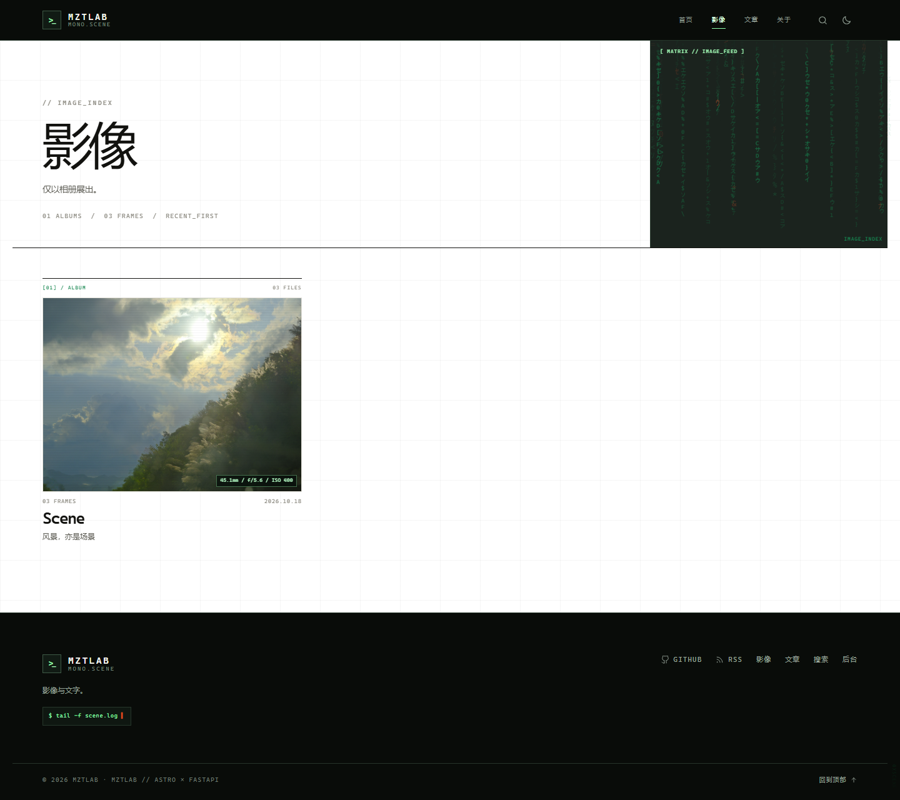
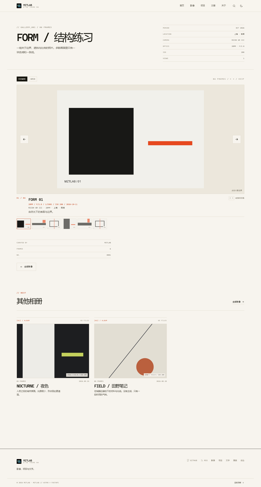
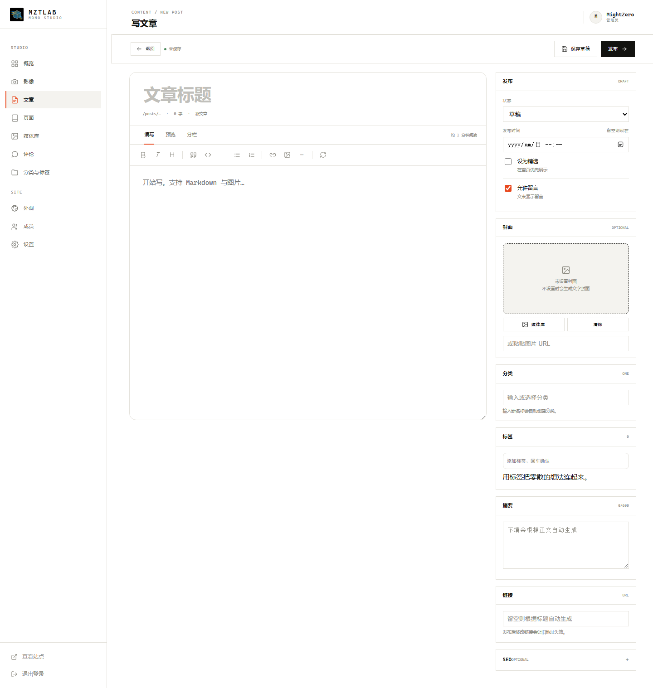
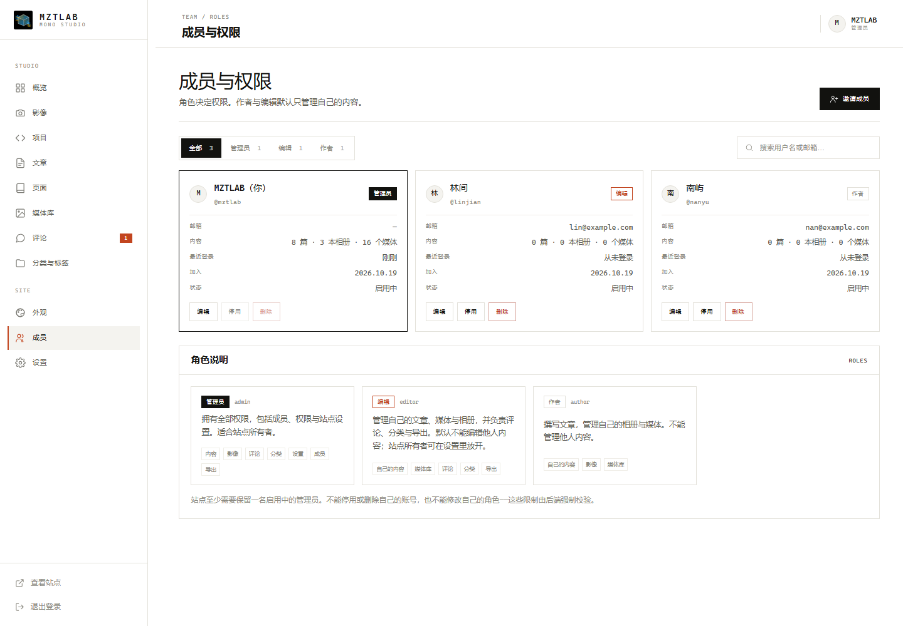

# MZTLAB · Scene

影像与文字。Astro 7 负责页面，FastAPI + SQLite 负责内容、认证与权限。

- **Scene 主题**：全站等宽字体、轻量代码标签与照片元数据，保持安静简约。
- **只按相册看照片**：`/photos` 是相册索引，照片只在已发布的相册里出现。
- **更完整的 EXIF**：焦距、等效焦距、光圈、快门、ISO、相机、镜头、时间与尺寸。
- **轻量后台**：文章、相册、媒体、评论、成员与细粒度权限。
- **无 SPA / 无 Redis**：一个 Astro 进程、一个 FastAPI 进程、一个 SQLite 文件。

开发文档（框架、模块职责、扩展与改代码的具体路径）见 [`docs/DEVELOPMENT.md`](docs/DEVELOPMENT.md)。

## 预览










## 技术架构

```text
浏览器
  │
  ▼
Astro 7 SSR (127.0.0.1:4321)
  ├── 公共页面：首页 / 影像索引 / 相册 / 文章 / 搜索 / 页面
  ├── 管理后台：概览 / 影像 / 文章 / 页面 / 媒体 / 评论 / 外观 / 成员
  └── /api/* 与 /media/* 代理
          │
          ▼
      FastAPI (127.0.0.1:8000)
          ├── scrypt 密码 + 数据库 Session + HttpOnly Cookie
          ├── 角色 → 权限键，逐接口校验 + 内容所有权
          ├── Markdown、版本、定时发布、评论
          ├── 相册、照片元数据、排序、封面、EXIF
          └── SQLite + 上传目录 (backend/data)
```

浏览器只访问 `4321`，Cookie 同源，无需 CORS。公共页面由 Astro 服务端取数，后台交互使用原生 TypeScript + `fetch`。

## 快速开始

需要 Python ≥ 3.11、Node.js ≥ 22.22。

```bash
python scripts/setup.py
python scripts/run.py --dev
```

也可以手动安装：

```bash
python -m venv backend/.venv
backend/.venv/Scripts/python -m pip install -r backend/requirements.txt   # Windows
backend/.venv/bin/python -m pip install -r backend/requirements.txt       # macOS / Linux
cd frontend && npm ci
```

打开：

- 站点：<http://127.0.0.1:4321>
- 后台：<http://127.0.0.1:4321/admin>
- API 文档：默认关闭（生产安全考虑）。本地开发可设 `BLOG_ENABLE_API_DOCS=true` 后访问 `http://127.0.0.1:4321/api/docs`。

快捷脚本：`.\start.ps1 -Dev` / `.\start.ps1`（Windows），`./start.sh --dev`（macOS / Linux）。`--dev` 会启动 Astro 开发服务器并暴露源码，只应在本机使用；默认生产模式则先构建再运行 `dist/server/entry.mjs`。

首次访问 `/admin` 会进入 `/admin/setup`，创建管理员。也可以设置 `BLOG_ADMIN_USER` / `BLOG_ADMIN_PASSWORD`，详见 `.env.example`。密码需至少 10 位，并包含小写字母、大写字母、数字、符号中的至少三类；常见弱口令会被拒绝。

演示内容默认包含 3 本相册（程序生成的色块图）、3 篇文章和一个「关于」页面，只写入一次。设置 `BLOG_SEED_DEMO=false` 从空站点开始。旧版本留下的项目数据会保留在数据库中，但不再有公开入口或后台入口。

## 主题

主题名 **Scene**。

1. **等宽**：正文、标题、按钮与元信息都使用 Mono 字体栈。
2. **代码标签**：`[01] / ALBUM`、`// IMAGE_INDEX`、文件名与 EXIF 读数，只做小号辅助信息。
3. **一个强调色**：默认 `#e8481d`，只用于链接、选中与编号。
4. **安静**：无字符雨、无终端配色、无渐变；靠 1px 线、留白和照片本身。

设计令牌在 `frontend/src/styles/global.css`；Mono 字体与轻量代码标签层在 `frontend/src/styles/mono.css`。后台可改强调色、宽度、圆角、相册列数与明暗模式。

| `theme` | 画布 |
| --- | --- |
| `scene`（默认） | 纯白 |
| `stone` | 冷调灰白 |
| `sand` | 暖调米色 |
| `night` | 深色画布 |

### 影像与相册

- `/photos` 只列相册，不再有全站照片流。
- `/galleries` 301 到 `/photos`；相册详情仍在 `/galleries/{slug}`。
- 首页主视觉使用精选相册封面，首页影像区也只展示相册卡片。
- 相册详情默认大图视图，支持 ← →、按钮、缩略图、滑动；可切网格；点图进入 Lightbox。
- 未发布相册、草稿照片与不属于相册的照片不会出现在公开页面。

### 文章归档

- `/archive` 按年份分组。
- 后台 → 外观 → 文章页面可切换 **网格 / 列表**。
- 两种布局都会显示文章封面；没有设置封面时使用自动生成的文字封面。

### 编辑器

- Markdown 工具栏包含标题、列表、代码、链接、图片、音乐与分隔线。
- 点击 **♫** 打开音频对话框，从媒体库选择音频，或填写音频 URL、标题与作者，即插入 HTML5 `<audio>` 播放器。
- 支持 `https://` 音频链接或站内 `/media/...` 路径；MP3 / M4A / OGG / WAV / FLAC 等由浏览器原生播放。
- 播放器构建在 `src/lib/audio-embed.ts`，对话框与编辑器事件解耦，后续可扩展播放列表。
- 媒体库同时支持图片与音频；音频卡片可直接试听、复制链接，并会出现在音频插入对话框里。

### EXIF

上传时读取并缓存到 `media.exif`。**EXIF 的编辑在媒体库**：图片卡片的「EXIF」按钮可补充相机、镜头、拍摄日期、焦距、光圈、快门、ISO 与等效焦距。已有值的字段为只读，不允许改写；保存只更新媒体库数据，不修改原始图像文件。

相册编辑页不再编辑 EXIF，只保留「显示 EXIF」面板，逐张勾选要公开的字段：

`相机 / 镜头 / 焦距 / 光圈 / 快门 / ISO / 拍摄时间 / 尺寸`

每行的 `EXIF` 链接会直接打开媒体库中对应图片的 EXIF 编辑器。默认全部显示；取消勾选后，该字段不会出现在相册信息、网格摘要、大图说明或 Lightbox 中。GPS 只在后台弹窗中可见。

## 内容模型

| 类型 | 表 | 说明 |
| --- | --- | --- |
| 文章 | `posts.type = 'post'` | Markdown、分类、标签、评论、定时发布、版本、所有者 |
| 页面 | `posts.type = 'page'` | 关于、联系等长期内容，URL 位于根目录 |
| 相册 | `galleries` | 标题、别名、描述、状态、精选、封面、所有者 |
| 照片 | `photos` | 指向 `media`，标题、说明、地点、器材、日期、排序、状态、EXIF 显示白名单 |
| 媒体 | `media` | 原图、尺寸、所有者、EXIF JSON |

### 公开路由

| 路径 | 内容 |
| --- | --- |
| `/` | 主视觉 + 相册 + 文字 |
| `/photos` | 相册索引 |
| `/galleries/{slug}` | 相册详情 |
| `/archive` | 文章归档 |
| `/posts/{slug}` | 文章详情 |
| `/search` | 搜索相册与文章 |
| `/{slug}` | 独立页面 |
| `/rss.xml` `/sitemap.xml` `/robots.txt` | 自动生成 |

### 相册工作流

1. 媒体库上传照片，自动读取 EXIF。
2. 影像 → 新建相册。
3. 从媒体库多选照片加入相册；自动带相机 / 镜头 / 日期。
4. 补标题、说明、地点，调整顺序与封面。
5. 设为已发布后出现在 `/photos` 与 `/galleries/{slug}`。

## 权限

| 角色 | 说明 |
| --- | --- |
| `admin` | 全部内容、影像、评论、分类、外观、成员、导出 |
| `editor` | 自己的文章 / 相册 / 媒体，评论、分类、导出；可被授权管理他人内容 |
| `author` | 自己的文章 / 相册 / 媒体 |

权限键：`content.read`、`content.write`、`content.publish`、`content.delete`、`content.others`、`media.manage`、`gallery.manage`、`comment.moderate`、`taxonomy.manage`、`settings.manage`、`users.manage`、`data.export`。

文章 / 页面 / 相册使用 `author_id`，媒体使用 `owner_id`。越权请求由后端返回 403。

## 项目结构

```text
backend/
  app/
    main.py             FastAPI 入口、静态媒体、CSRF 头
    db.py               SQLite、设置、v4 迁移
    defaults.py         默认文案 / 导航 / 主题值
    posts.py            文章 / 页面查询与序列化
    galleries.py        相册 / 照片 / EXIF 公开字段
    exif.py             EXIF 解析、JSON 安全化
    routes/public.py    公共读取、相册、搜索、评论
    routes/admin.py     文章 / 页面 / 设置 / 统计
    routes/gallery_admin.py
    routes/media.py
    seed.py             首次演示内容
  tests/
frontend/
  src/
    pages/              公共页 + admin
    components/         Header / Hero / GalleryCard / Viewer / Lightbox
    styles/global.css   Scene 设计系统
    styles/mono.css     Mono 字体与代码标签层
    scripts/            原生 TS
    lib/                API、权限、EXIF、格式化
scripts/                setup / run
```

## API 摘要

| 方法 | 路径 | 说明 |
| --- | --- | --- |
| GET | `/api/site` | 设置、分类、标签、计数 |
| GET | `/api/galleries` | 已发布相册 |
| GET | `/api/galleries/{slug}` | 相册详情与照片 |
| GET | `/api/posts` | 文章列表 |
| GET | `/api/posts/{slug}` | 文章详情 |
| GET | `/api/archive` | 文章归档 |
| GET | `/api/search?q=` | `articles` + `galleries` |
| POST | `/api/galleries/{id}/view` | 相册浏览数 |
| POST | `/api/posts/{id}/comments` | 提交评论 |
| GET | `/api/admin/stats` | 后台统计（需登录） |
| GET / PUT | `/api/admin/posts...` | 文章 / 页面 |
| GET / POST | `/api/admin/galleries...` | 相册 |
| GET / POST | `/api/admin/photos...` | 相册照片 |
| GET / POST | `/api/admin/media...` | 媒体与 EXIF |
| GET / PUT | `/api/admin/settings` / `appearance` | 设置 |

`/api/projects`、`/api/photos` 与 `/projects` 已移除。

## 运维

- 数据：`backend/data/blog.db` + `backend/data/uploads/`。备份整个目录即可。
- 导出：后台 → 设置 → 导出；包含文章、页面、相册、照片、媒体元数据、评论、分类、标签与公开设置，不含密码哈希与媒体二进制。
- 数据库升级由 `PRAGMA user_version` 管理（当前 `SCHEMA_VERSION = 5`，定义在 `backend/app/db.py`）。迁移会在启动时幂等执行：补列、回填所有者与 EXIF、把旧主题值映射到 Scene。
- 测试：`cd backend && .venv/Scripts/python -m unittest discover -s tests`。
- 构建：`cd frontend && npm run check && npm run build`。

### 安全配置

- **只暴露前端端口**：FastAPI 监听 `127.0.0.1:8000`（Docker 中仅容器内网），并必须带 `--no-proxy-headers` 启动；`8000` 不要映射到公网。
- **代理密钥**：`scripts/run.py` 每次运行会随机生成 `BLOG_PROXY_SECRET` 供前后端使用；Docker 部署需在启动前设置随机值（例如 `BLOG_PROXY_SECRET=$(python -c "import secrets;print(secrets.token_urlsafe(32))")`，或写入 compose 同目录的 `.env`），后端只信任带该密钥请求中的 `x-blog-real-ip`。
- **HTTPS**：启用后设置 `BLOG_COOKIE_SECURE=true`（`BLOG_SITE_URL` 以 `https://` 开头时会自动开启），并由反向代理下发 HSTS；站点已内置 CSP、XFO、nosniff、Referrer-Policy、Permissions-Policy。
- **API 文档**：`/api/docs`、`/api/openapi.json` 默认关闭，仅在 `BLOG_ENABLE_API_DOCS=true` 时开启。
- **登录防护**：失败限流按 IP、IP+账号、账号三层计数并指数退避；登录成功会清零。会话默认 7 天，改密/停用/改角色会吊销该用户全部会话。

## FAQ

**为什么没有项目了？**  
项目不再作为内容类型出现在导航、首页、搜索或后台。历史数据库列保留，方便回滚，但不会继续展示。

**照片能单独发布吗？**  
公开侧不能。照片必须属于已发布相册；媒体库与后台仍可单独管理文件。

**EXIF 会公开 GPS 吗？**  
不会。公开侧只展示技术参数；GPS 在后台弹窗中查看。

**可以换回浅色 / 深色吗？**  
可以。右上角切换，后台可设默认明暗模式；Mono 字体保持不变。

演示内容为虚构示例。项目未附带许可证文件，公开使用前请自行补充。
