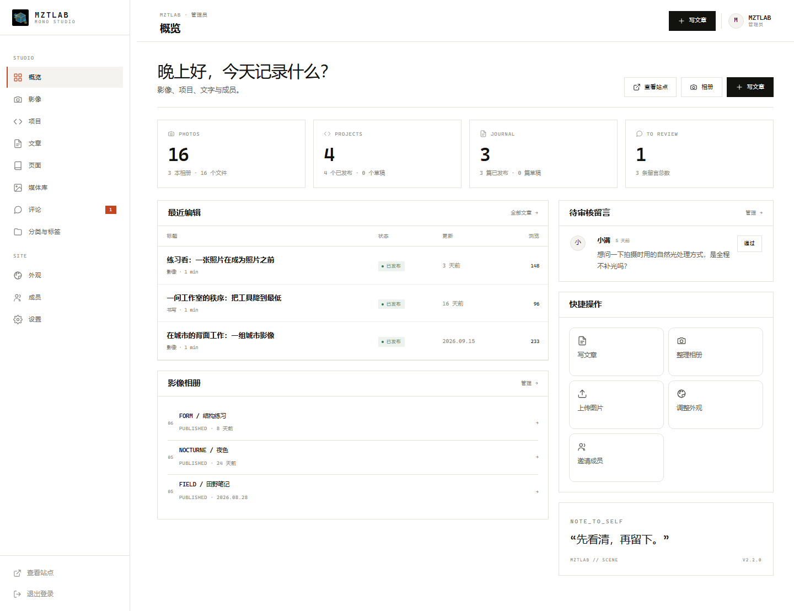

# MZTLAB · Scene

> 适用版本：3.0.0

影像、项目与文字。Astro 7 负责页面，FastAPI + SQLite 负责内容、认证与权限。

MZTLAB · Scene 是一个面向个人工作室的极简作品集站点：照片按相册组织，项目与文章由同一套内容系统管理。3.0.0 是一次彻底的架构收敛——单层接入、无评论、无浏览量统计、派生图按产物寻址，并为未来的静态化迁移预留了接口与数据形状。

## 定位与能力

- **三种内容并列**：相册（影像）、项目、文章（文字）共用一套所有权、权限与后台体验，不把任何一组做成附属。
- **影像优先**：上传后生成多尺寸 AVIF / WebP / JPEG 派生图；照片保留完整 EXIF（相机、镜头、焦距、光圈、快门、ISO、地点等），相册内支持排序、封面与下载入口开关。
- **项目是自由类型**：直接填写「代码」「影像」「字体设计」等任意类型；项目只放文字介绍，不接受视频文件。
- **文章**：Markdown 写作、草稿/发布/定时发布、分类与标签、修订历史、目录与阅读时长、站内全文搜索。
- **后台**：文章、项目、相册、媒体库、分类标签、外观与设置、成员与权限；角色为管理员 / 编辑 / 作者，权限矩阵只在后端定义。
- **轻量运行**：一个 Astro 进程、一个 FastAPI 进程、一个 SQLite 文件；无 Redis、无外部消息队列、无 SPA。

## 技术栈与进程拓扑

- 前端：Astro 7（SSR，`output: 'server'`）+ 原生 TypeScript；无前端框架。
- 后端：FastAPI + 标准库 `sqlite3`（WAL）+ Pillow（AVIF/WebP/JPEG 派生图）+ boto3（可选 S3/R2）。
- 部署是**单层接入**：

```text
浏览器
  │  HTTPS（TLS/HSTS 由接入层负责）
  ▼
平台 nginx（运维维护，仓库不提交其配置）
  ├── /api/    → 127.0.0.1:8000（FastAPI）
  ├── /media/  → 127.0.0.1:8000（FastAPI，关闭代理缓冲）
  └── /*       → 127.0.0.1:4321（Astro SSR：公共页 + /admin + /_astro 资产）
```

- **仓库不包含 nginx 配置文件**。接入层只保留这一层，不引入第二层边缘代理；必须满足的路由、转发头、体积、缓冲、压缩与上线核对清单见 [`docs/EDGE.md`](docs/EDGE.md)。
- 生产环境两个应用进程只监听回环/私有网络，不得直接暴露公网；公共页与 `/admin` 由 Astro 渲染，`/api`、`/media` 由 FastAPI 提供。
- 本地开发**不涉及 nginx**：Astro/Vite 仅 dev 生效的 proxy 把 `/api`、`/media` 转发到本机 FastAPI，浏览器保持同源 `http://127.0.0.1:4321`。

## 快速开始

需要 **Python ≥ 3.11**、**Node.js ≥ 22.22**。

```bash
# 1. 安装依赖（自动创建 backend/.venv、npm ci）
python scripts/setup.py

# 2. 开发模式（热更新；会打印安全提示，仅限本机）
python scripts/run.py --dev
```

打开 <http://127.0.0.1:4321/admin/setup> 创建第一个管理员账号，然后从后台开始。

```bash
# 生产模式（先构建 Astro，再以 node dist/server/entry.mjs 启动）
python scripts/run.py

# 仅初始化数据库 / 查看状态 / 校验
python scripts/db.py migrate
python scripts/db.py status
python scripts/db.py verify
```

也可用 Docker Compose（两个服务：`backend`、`frontend`）：

```bash
docker compose up -d --build
```

`docker-compose.yml` 只把端口发布到宿主机回环，供运维 nginx 反向代理；compose 不包含接入层。

## 数据与升级政策

- 数据库结构版本为 **`SCHEMA_VERSION = 3`**，由 `backend/migrations/*.sql` 版本化 SQL 建库。
- **只支持空库初始化**：3.0.0 不迁移、不导入 2.x 数据库。启动时若发现旧库或非 3.0.0 结构会**明确报错**并提示清空 `BLOG_DATA_DIR`。
- 结构变更由人/CI 显式执行 `python scripts/db.py migrate`；应用启动不会自动迁移数据。
- 演示内容默认关闭：只有 `BLOG_SEED_DEMO=true` 时首次启动才写入示例内容，且只写入一次。
- 从 2.x 升级 = 重新部署 3.0.0 + 空库初始化 + 重新录入内容（如需要，使用后台导出/导入做同版本备份恢复）。**无 2.x 导入通道**。
- 配置分五组存储：`site`、`appearance`、`copy`、`upload`、`advanced`；S3 访问密钥只来自环境变量，不写入数据库。

## 图片管线

- 每张上传的图片保留原图，按需生成 `thumb / tile / card / hero / viewer / prose / full` 多场景、多宽度的 AVIF / WebP / JPEG 派生图。
- 编码质量与参数是代码常量 `PIPELINE_DEFAULTS`（不可在后台逐图修改）；改变它们需要同时提升 `PIPELINE_VERSION`。
- 派生图地址是**产物级 token**：`token = sha1(PIPELINE_VERSION | media_id | source_sha1 | scene | width | format | quality)` 的前 10 位。URL 只由产物本身决定，改配置不会让已发布页面失效。
- `media.derivative_set` 物化「已就绪」的产物集合；读路径只组装已有产物、**永不现场编码**，未就绪时前端回退原图。
- **存量图像不会自动重编码**：升级管线只影响新上传；需要全量或按范围重编码时，在后台创建 `reencode` 任务（可取消、有进度），它不会在请求路径上发生。
- 存储可选本地磁盘或 S3 兼容对象存储（R2 为参考实现）；存储坐标在后台设置，凭据只在环境变量。

## 运维要点

- **备份**：`python scripts/backup.py`（SQLite 在线备份 + 校验，`--include-media` 同时打包 `uploads/`、`cache/`）；恢复流程见脚本头部说明。**恢复演练已验证**：备份 → 恢复到第二个数据目录 → `python scripts/db.py verify`（完整性/外键/结构版本）→ 启动并核对 `/api/site`、`/api/posts` 计数一致。
- **后台任务**：所有维护动作（prewarm / reencode / gc_derivatives / storage_sync / export）都是 `jobs` 表中的持久任务，由单 worker 线程消费；重启不丢任务，心跳超时会回收重试。
- **单进程约束**：应用层限流与设置缓存都在进程内存，**必须单 worker 运行**；`WEB_CONCURRENCY > 1` 会拒绝启动。
- **接入层自检**：`GET /api/health/edge` 返回应用实际观测到的 `client_ip`、`forwarded_for`、`forwarded_proto`、`request_id`、`trusted_proxy`、`cookie_secure`，用于 staging/生产按 `docs/EDGE.md` 逐条核对。
- **HSTS / TLS** 由接入层负责，应用不设置 HSTS；Cookie 的 `Secure` 由 `BLOG_SITE_URL` 是否为 https 推导。
- 环境变量清单与默认值见 [`.env.example`](.env.example)。

## 常用命令

| 命令                                                                        | 用途                                                                                                                                                                                   |
| --------------------------------------------------------------------------- | -------------------------------------------------------------------------------------------------------------------------------------------------------------------------------------- |
| `python scripts/setup.py`                                                   | 安装后端虚拟环境与前端依赖                                                                                                                                                             |
| `python scripts/run.py --dev`                                               | 开发模式（Astro dev + FastAPI，热更新）                                                                                                                                                |
| `python scripts/run.py`                                                     | 生产模式（构建 Astro 后启动两进程）                                                                                                                                                    |
| `python scripts/db.py migrate/status/verify`                                | 建库 / 查看结构版本与行数 / 完整性校验                                                                                                                                                 |
| `python scripts/backup.py [--include-media]`                                | 在线备份数据库（可选媒体）                                                                                                                                                             |
| `python scripts/sync_storage.py`                                            | 强制把本地媒体同步到对象存储                                                                                                                                                           |
| `python scripts/prune_derivatives.py`                                       | 清理无引用的派生图                                                                                                                                                                     |
| `python scripts/optimize_media.py`                                          | 存量媒体维护（按需运行）                                                                                                                                                               |
| `python scripts/verify.py`                                                  | **一键验收**：ruff/mypy/pytest、契约与文档漂移、公共页审计、前端 check/lint/build 与运行时 smoke；加 `--skip-slow` 跳过慢步骤（`scripts/verify.sh` / `scripts/verify.ps1` 为等价包装） |
| `cd backend && python -m pytest`                                            | 后端测试                                                                                                                                                                               |
| `cd frontend && npm run check && npm run lint && npm test && npm run build` | 前端检查、测试与构建                                                                                                                                                                   |
| `cd backend && python -m app.scripts.export_contracts`                      | 导出 `frontend/src/api/openapi.json`                                                                                                                                                   |
| `cd frontend && npm run gen:types`                                          | 由 OpenAPI 生成前端类型                                                                                                                                                                |
| `cd backend && python -m app.scripts.gen_docs`                              | 生成 `docs/SCHEMA.md` 与 `docs/API.md`                                                                                                                                                 |

## 文档索引

| 文档                                                                           | 内容                                                                   |
| ------------------------------------------------------------------------------ | ---------------------------------------------------------------------- |
| [`docs/DEVELOPMENT.md`](docs/DEVELOPMENT.md)                                   | 维护者手册：架构、数据层、配置、写入管线、授权、媒体、契约生成、测试   |
| [`docs/CSS.md`](docs/CSS.md)                                                   | 样式系统维护手册：分层、令牌（字号/断点/语义颜色）、组件归属与级联验证 |
| [`docs/EDGE.md`](docs/EDGE.md)                                                 | 接入层（nginx）要求与上线核对清单（不含可部署配置）                    |
| [`docs/SCHEMA.md`](docs/SCHEMA.md)                                             | 数据库结构（脚本生成，勿手改）                                         |
| [`docs/API.md`](docs/API.md)                                                   | API 端点表（脚本生成，勿手改）                                         |
| [`docs/SSG-FEASIBILITY.md`](docs/SSG-FEASIBILITY.md)                           | 静态化可行性、阻塞项与 3.0.0 预留状态                                  |
| [`docs/archive/`](docs/archive/README.md)                                      | 2.x 历史文档归档（仅追溯，勿据此部署）                                 |
| [`docs/archive/3.0.0/REFACTOR-3.0.0.md`](docs/archive/3.0.0/REFACTOR-3.0.0.md) | 3.0.0 重构方案与决策记录（已归档的历史方案）                           |

## 预览




## 许可证

本项目采用 [MIT License](LICENCE) 发布。Copyright © 2026 MZTLAB。
